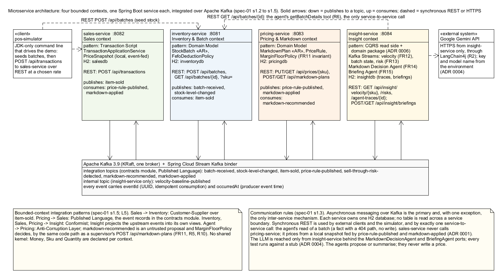

# FreshFlow

**Real-time expiry risk detection and agentic markdown decision support for grocery retail.**
CSCI318 Software Engineering Practices & Principles, Spring 2026, Group 06 "318 Hero":
Zihua (Andy) Zeng, Reuben Kruger, Modhuri (Madhuri) Dey Sithi.

A supermarket throws away perishable stock that reaches its expiry date unsold. FreshFlow
watches point-of-sale scans as they happen, works out which batches will not sell out before
they expire, and asks an LLM agent to propose a markdown for those batches. The agent may only
propose. Whether a markdown is allowed is decided by a deterministic rule, the margin floor,
inside the pricing service's domain layer, and that rule applies identically whether the
proposal came from a person or from the agent.

## Architecture at a glance

| Bounded context | Service | Port | Domain pattern | Owns |
|---|---|---|---|---|
| Inventory & Batch | `inventory-service` | 8081 | Domain Model | stock batches, FEFO deduction, idempotent event ledger |
| Sales | `sales-service` | 8082 | Transaction Script | sale transactions, local price snapshot |
| Pricing & Markdown | `pricing-service` | 8083 | Domain Model | price rules, margin floors, markdown plans |
| Insight | `insight-service` | 8084 | CQRS read side + domain rules | Kafka Streams velocity and risk views, the two agents |

Supporting modules: `contracts` (the Published Language: the integration event records) and
`pos-simulator` (a command-line client that drives the demonstration).

Services communicate through Apache Kafka with Spring Cloud Stream. The only synchronous call
between services is the agent's `getBatchDetails` tool, a `GET` from insight-service to
inventory-service. Each service owns its own H2 database. The full design is in `specs/`,
the decisions that the specifications did not settle are in `docs/decisions/`, and every AI
collaboration session is logged in `docs/ai-log/`.

<p align="center"></p>

The closed loop the demonstration shows:

```
sale (POST /api/transactions)  -> item-sold
  -> inventory deducts FEFO     -> stock-level-changed
  -> insight windows velocity (FR12) and joins batch state (FR13)
  -> sell-through-risk-detected -> Markdown Decision Agent (FR14) -> markdown-recommended
  -> pricing checks the margin floor (FR11): ACTIVE plan + markdown-applied, or REJECTED
  -> sales applies the discounted price at the next scan (FR6b)
  -> store owner asks the Briefing Agent for the day's summary (FR15)
```

## Prerequisites

| Tool | Version | Check |
|---|---|---|
| JDK | 21 | `java -version` |
| Docker Desktop | any recent | `docker info` prints a server version. Docker is used only for Kafka; an unpacked Kafka on `localhost:9092`, started the way the coordinator's `cargo-tracker-0.1` README does it, works unchanged |
| Git | any | `git --version` |
| Maven | not needed; the wrapper `mvnw.cmd` / `mvnw` is committed | |
| A Google AI Studio API key | for FR14 and FR15 only | https://aistudio.google.com/apikey |

Everything else (Spring Boot 3, Spring Cloud Stream, Kafka Streams, LangChain4j 1.20.0, H2)
is resolved by Maven. No dependency outside the approved list in `specs/spec-01-architecture.md`
section 1.1 is used.

## Configuration

All configuration is in each service's `src/main/resources/application.yml`. Only the LLM
settings come from the environment, and the key is never written to any file:

| Variable | Used by | Meaning |
|---|---|---|
| `LLM_API_KEY` | insight-service | Google AI Studio key. When absent the service starts, serves FR12 and FR13, and logs that the agents are not configured |
| `LLM_MODEL` | insight-service | Model name. Use `gemini-3.5-flash-lite`: it is the model the coordinator's own `customer-support-agent` uses, it completed the whole loop (FR14 and FR15) in the live run of 5 October 2026, and its free daily quota is far larger than the twenty requests a day the free tier allowed `gemini-3.6-flash` (the model of the 4 October run, which still works while its quota lasts). Google restricted the `gemini-2.5` series to existing users in September 2026 and lists it for retirement in October 2026, so do not rely on it |
| `LLM_PROVIDER` | insight-service | Defaults to `google-ai-gemini`; the only provider module built in |
| `FRESHFLOW_KAFKA_BROKERS` | all services | Defaults to `localhost:9092` |

Set them in the PowerShell window that will start insight-service (they live only in that window):

```powershell
$env:LLM_API_KEY = "paste-your-key-here"
$env:LLM_MODEL   = "gemini-3.5-flash-lite"
```

## Quick start, the one-command way (PowerShell on Windows)

Three scripts in `scripts/` do the whole procedure below for you, each in the right order, and
write every service's console to `logs/`:

```powershell
.\scripts\start-all.ps1 -Fresh
```

`-Fresh` wipes Kafka's data and insight-service's Kafka Streams state first, so the run starts
from nothing; leave it out to keep the broker's data. The script checks Java and Docker, starts
Kafka and waits for `healthy`, builds the jars if any is missing (`-Build` forces it), sets the
model name for insight-service (`-Model`, default `gemini-3.5-flash-lite`; the key is read from
`LLM_API_KEY` in your window and never written anywhere), opens one window per service and waits
until all four ports answer. `-NoAgent` starts without a model (FR12 and FR13 only).

```powershell
.\scripts\demo.ps1
```

Runs the closed loop (about four minutes) and, because the consoles are in `logs/`, finds the
agent's trace and the plan pricing-service made from it by itself.

```powershell
.\scripts\stop-all.ps1
```

Stops the four services; `-Kafka` also stops the broker, `-Kafka -Wipe` discards its data.

## Quick start, step by step (PowerShell on Windows)

Open PowerShell in the repository root for each step. Six terminals are comfortable: one for
Kafka, four for the services, one for requests.

**1. Start Kafka** (single node, KRaft mode, from `docker-compose.yml`):

```powershell
docker compose up -d
docker compose ps
```

Wait until the `kafka` container reports `healthy`.

**2. Build everything, run the tests and install the modules** (about three minutes the first time):

```powershell
.\mvnw.cmd clean install
```

The build ends with `BUILD SUCCESS`. Add `-o` to work offline once the dependencies are cached.
`install` matters: step 3 starts each service on its own, and a per-module `spring-boot:run`
resolves the shared `contracts` jar from the local Maven repository, so an un-installed change to
an event class shows up as `ClassNotFoundException` at start-up.

**3. Start the four services, one per terminal, in this order** (pricing before sales so the
price snapshot is populated; insight last so its topology finds the topics):

```powershell
.\mvnw.cmd -pl inventory-service spring-boot:run
```
```powershell
.\mvnw.cmd -pl pricing-service spring-boot:run
```
```powershell
.\mvnw.cmd -pl sales-service spring-boot:run
```
```powershell
# in the window where LLM_API_KEY and LLM_MODEL are set
.\mvnw.cmd -pl insight-service spring-boot:run
```

Each service logs `Started ...Application` when ready. insight-service logs the model name it
is using, or `[fr14-not-configured]` style warnings if no key is set.

**4. Run the demonstration script**, which seeds a price rule, registers batches, drives sales
through the POS simulator and prints every read model as it changes:

```powershell
.\scripts\demo.ps1
```

**5. Or drive it by hand** with the sample requests below, or with the Postman collection at
`docs/postman/FreshFlow.postman_collection.json` (one folder per service, in demonstration
order, with collection variables for the ids).

**6. Stop**: `Ctrl+C` in each service window, then `docker compose down`.

### Running from IntelliJ IDEA instead

Open the repository root as a Maven project. The `.run/` folder ships run configurations:
`0 FreshFlow: all four services` starts everything, and `5 pos-simulator` drives the demo.
For insight-service either start IntelliJ from a shell where `LLM_API_KEY` and `LLM_MODEL`
are exported, or add them under *Run > Edit Configurations > Environment variables*. Kafka
still has to be started with `docker compose up -d` first.

### Linux or macOS

Use `./mvnw` instead of `.\mvnw.cmd`, `export LLM_API_KEY=...` instead of `$env:`, and `curl`
instead of `Invoke-RestMethod`. Nothing else differs.

## Sample inputs, one per use case

Section 2.1 of the report specifies twelve use cases (`docs/report/section-2-1-use-cases.md`).
Each is driven by one of the requests below. PowerShell's `Invoke-RestMethod` is used because
single-quoted PowerShell strings keep the JSON quotes intact; `curl` equivalents are one line
each and are in the Postman collection. Outputs are in Section 4.2 of the report.

**UC-06 / FR8, create or replace a price rule and its margin floor** (pricing, 8083)

```powershell
Invoke-RestMethod -Method Put -Uri http://localhost:8083/api/prices/SKU-STR-250G -ContentType 'application/json' -Body '{"basePrice":{"amount":6.00,"currency":"AUD"},"unitCost":{"amount":3.00,"currency":"AUD"},"category":"PRODUCE","marginFloorRatio":0.20}'
Invoke-RestMethod -Uri http://localhost:8083/api/prices/SKU-YOG-1KG
```

`SKU-YOG-1KG` is seeded on start-up (base 4.50, cost 2.10, floor 0.15) and announced on
`price-rule-published`, which is how sales-service learns the price.

**UC-01 / FR1, register a goods receipt** (inventory, 8081). Use an expiry in the future.

```powershell
$batch = Invoke-RestMethod -Method Post -Uri http://localhost:8081/api/batches -ContentType 'application/json' -Body '{"sku":"SKU-YOG-1KG","quantity":400,"expiryAt":"2027-02-18T22:00:00Z","unitCost":{"amount":2.10,"currency":"AUD"},"supplierRef":"DEL-88213"}'
$batch
```

A quantity of `0` or an expiry in the past answers `400` with the rule that refused it.

**UC-03 / FR4, query stock and remaining shelf life** (inventory, 8081)

```powershell
Invoke-RestMethod -Uri "http://localhost:8081/api/batches/$($batch.batchId)"
Invoke-RestMethod -Uri "http://localhost:8081/api/batches?sku=SKU-YOG-1KG"
```

**UC-04 and UC-05 / FR5 and FR6a, record a sale at the base price** (sales, 8082)

```powershell
Invoke-RestMethod -Method Post -Uri http://localhost:8082/api/transactions -ContentType 'application/json' -Body '{"tillId":"TILL-02","lineItems":[{"sku":"SKU-YOG-1KG","quantity":2}]}'
```

**UC-02 / FR2, stock is deducted first-expired-first-out.** Read the batch again; the remaining
quantity has dropped by 2 and `stock-level-changed` has been published:

```powershell
Invoke-RestMethod -Uri "http://localhost:8081/api/batches/$($batch.batchId)"
```

**UC-09 / FR12, rolling sell-through velocity** (insight, 8084). Available once the first
60-second window has closed; `404` before that is the specified answer.

```powershell
Invoke-RestMethod -Uri http://localhost:8084/api/insight/velocity/SKU-YOG-1KG
```

**UC-10 / FR13, batches at risk of expiring unsold** (insight, 8084)

```powershell
Invoke-RestMethod -Uri http://localhost:8084/api/insight/risks
```

A risk appears when a batch's remaining quantity exceeds what its current velocity can sell
before expiry. The simulator's `--seed-batches=true` registers 400 units expiring in 70 minutes
for exactly this purpose.

**UC-11 / FR14, the Markdown Decision Agent.** Triggered by the risk event, not by a request.
Watch insight-service's log for `[fr14-trace] agentTraceId=TRC-...`, then read the trace:

```powershell
Invoke-RestMethod -Uri http://localhost:8084/api/insight/agent-traces/TRC-XXXXXXXX
```

**UC-07 / FR9, activate a markdown plan within the margin floor** (pricing, 8083). The agent's
recommendation arrives on `markdown-recommended` and runs the same path; a supervisor can also
propose directly:

```powershell
$plan = Invoke-RestMethod -Method Post -Uri http://localhost:8083/api/markdown-plans -ContentType 'application/json' -Body ('{"batchId":"' + $batch.batchId + '","sku":"SKU-YOG-1KG","discountTier":"PERCENT_30","effectiveFrom":"2026-10-01T00:00:00Z","effectiveTo":"2027-02-18T22:00:00Z","origin":"HUMAN","rationale":"Clearance before the weekend"}')
$plan
```

**UC-08 / FR11, a markdown that breaches the floor is refused with 422** and the refusal is
kept. `PERCENT_60` on the seeded SKU yields a negative margin:

```powershell
try { Invoke-RestMethod -Method Post -Uri http://localhost:8083/api/markdown-plans -ContentType 'application/json' -Body ('{"batchId":"' + $batch.batchId + '","sku":"SKU-YOG-1KG","discountTier":"PERCENT_60","effectiveFrom":"2026-10-01T00:00:00Z","effectiveTo":"2027-02-18T22:00:00Z","origin":"AGENT","rationale":"Aggressive clearance","agentTraceId":"TRC-DEMO-0002"}') } catch { $_.ErrorDetails.Message }
Invoke-RestMethod -Uri "http://localhost:8083/api/markdown-plans/$($plan.markdownPlanId)"
```

**UC-05 / FR6b, the markdown reaches the till.** After the 201 above, `GET /api/prices/SKU-YOG-1KG`
shows `effectivePrice` 3.15 and `activeDiscountTier` PERCENT_30, and the next sale records
`markdownApplied: true`:

```powershell
Invoke-RestMethod -Uri http://localhost:8083/api/prices/SKU-YOG-1KG
Invoke-RestMethod -Method Post -Uri http://localhost:8082/api/transactions -ContentType 'application/json' -Body '{"tillId":"TILL-02","lineItems":[{"sku":"SKU-YOG-1KG","quantity":1}]}'
```

**UC-12 / FR15, the end-of-day briefing** (insight, 8084; needs the LLM key)

```powershell
$briefing = Invoke-RestMethod -Method Post -Uri http://localhost:8084/api/insight/briefings -ContentType 'application/json' -Body '{}'
$briefing
Invoke-RestMethod -Uri "http://localhost:8084/api/insight/briefings/$($briefing.briefingId)"
```

Without a key the endpoint answers `503 AGENT_NOT_CONFIGURED`, which is the specified behaviour. With a
key whose model cannot be used just now (a spent daily quota, a timeout) it answers
`503 AGENT_UNAVAILABLE` with the reason, stores nothing, and the rest of the service is unaffected.

### The POS simulator

```powershell
java -cp "pos-simulator\target\classes;contracts\target\classes" com.freshflow.possimulator.PosSimulator --rate=4 --duration=180 --seed-batches=true
```

Keep `--rate` low when you want FR13 to fire: at 4 transactions a minute the seeded 400-unit batch
sells about 240 units an hour against the hour or so it has left, so it is flagged; at the
simulator's built-in default of 30 a minute it clears on its own and is never at risk.

Options: `--sales-url`, `--inventory-url`, `--rate` (transactions per minute, default 30), `--duration`
(seconds), `--seed` (deterministic randomness), `--skus=SKU:weight,...`, `--till`,
`--seed-batches`. On Linux or macOS the classpath separator is `:`.

### Watching the event stream

Every topic can be read with the console consumer inside the Kafka container, which is the
quickest way to show the closed loop during a demonstration:

```powershell
docker exec -it freshflow-kafka /opt/kafka/bin/kafka-console-consumer.sh --bootstrap-server localhost:9092 --topic item-sold --from-beginning
```

Replace the topic with `batch-received`, `stock-level-changed`, `sell-through-risk-detected`,
`markdown-recommended`, `markdown-applied` or `price-rule-published`.

### The agents, where to look

| Concern | Class |
|---|---|
| The port the orchestrator depends on | [`MarkdownDecisionAgent.java`](insight-service/src/main/java/com/freshflow/insight/application/MarkdownDecisionAgent.java), [`BriefingAgent.java`](insight-service/src/main/java/com/freshflow/insight/application/BriefingAgent.java) |
| The three tools of each agent | [`AgentToolRegistry.java`](insight-service/src/main/java/com/freshflow/insight/application/AgentToolRegistry.java), [`BriefingToolRegistry.java`](insight-service/src/main/java/com/freshflow/insight/application/BriefingToolRegistry.java) |
| The orchestration rules (idempotency, refusing a foreign batch, the three outcomes) | [`MarkdownAgentOrchestrator.java`](insight-service/src/main/java/com/freshflow/insight/application/MarkdownAgentOrchestrator.java), [`BriefingOrchestrator.java`](insight-service/src/main/java/com/freshflow/insight/application/BriefingOrchestrator.java) |
| The LangChain4j adapter and the system prompt | [`LangChain4jMarkdownDecisionAgent.java`](insight-service/src/main/java/com/freshflow/insight/infrastructure/LangChain4jMarkdownDecisionAgent.java), [`LangChain4jBriefingAgent.java`](insight-service/src/main/java/com/freshflow/insight/infrastructure/LangChain4jBriefingAgent.java) |
| Model construction, guarded by profile and by the presence of the key | `infrastructure/MarkdownAgentConfiguration.java`, `infrastructure/BriefingAgentConfiguration.java` |
| The persisted trace | `infrastructure/AgentTraceEntity.java`, `ToolCallEntity.java`, `BriefingEntity.java` |
| The guard that keeps pricing out of this service | `src/test/java/com/freshflow/insight/AntiCorruptionLayerGuardTest.java` |

The agents' configuration keys are `freshflow.llm.provider`, `model`, `api-key`, `timeout`
(60 s) and `max-steps` (8), in `insight-service/src/main/resources/application.yml`.

### Stream processing, where to look

| Concern | Class |
|---|---|
| The topology: hopping window on event time, batch-state table, stream-table join, the risk transition | [`InsightTopologyConfiguration.java`](insight-service/src/main/java/com/freshflow/insight/infrastructure/InsightTopologyConfiguration.java) (the role `StreamProcessor` plays in the coordinator's `cargo-tracker-0.1`) |
| Event time, one extractor for every input topic | [`OccurredAtTimestampExtractor.java`](insight-service/src/main/java/com/freshflow/insight/infrastructure/OccurredAtTimestampExtractor.java) |
| Interactive queries behind the application ports | [`InteractiveQueryVelocityWindowStore.java`](insight-service/src/main/java/com/freshflow/insight/infrastructure/InteractiveQueryVelocityWindowStore.java), `InteractiveQueryRiskViewStore.java` (cargo-tracker's `InteractiveQuery`) |
| The rule that decides a batch is at risk | [`RiskAssessmentPolicy.java`](insight-service/src/main/java/com/freshflow/insight/domain/RiskAssessmentPolicy.java) (domain package, ADR 0006) |

## Troubleshooting

| Symptom | Cause and fix |
|---|---|
| `GET /api/insight/velocity/{sku}` answers 404 | No 60-second window has closed for that SKU yet, or the last one aged out of the 10-minute retention. Keep sales flowing and retry |
| No risk appears | The batch clears at the current velocity. The simulator's seeded batch (400 units, 70 minutes to expiry) is only at risk while sales stay below roughly 6 transactions a minute, which is why `demo.ps1` defaults to 4; a run at the simulator's own default of 30 a minute sells the batch out instead. Check `GET /api/batches?sku=` shows it ACTIVE |
| insight-service logs `[fr14-not-configured]` | `LLM_API_KEY` is not set in the window that started it. Set it and restart that service only |
| `POST /api/insight/briefings` answers 503 `AGENT_NOT_CONFIGURED` | Same cause as above |
| `POST /api/insight/briefings` answers 503 `AGENT_UNAVAILABLE`, or insight-service logs `[fr14-agent-unavailable]` | The model is configured but refused the call; the body names the reason. The commonest cause is the Gemini free tier's daily request quota for that model (a 429 whose message says `GenerateRequestsPerDayPerProjectPerModel-FreeTier`). Set `LLM_MODEL` to a different model name and restart insight-service, or wait for the quota to reset; nothing was stored and FR12 and FR13 are unaffected |
| insight-service logs `Failed to change permissions for the directory ...\kafka-streams` at start-up | Kafka Streams tries to set POSIX permissions on its state directory, which Windows does not support. The message is logged at ERROR level but is harmless: the topology starts and the stores work |
| Gemini answers 400 about a thought signature | Fixed in `MarkdownAgentConfiguration` (`sendThinking`, `returnThinking`); make sure you are on the current `main` |
| A markdown stopped applying at the till after pricing-service was restarted | On start-up pricing-service re-announces its seeded rules with a fresh timestamp, and sales-service treats a newer rule as displacing the markdown attached to it (logged `[displaced]`). Activate the markdown again, or restart sales-service after pricing-service so both topics replay in order |
| Kafka Streams fails to start after a crash | Stop insight-service, delete its state directory (`/tmp/kafka-streams` on Linux or macOS, `%TEMP%\kafka-streams` on Windows) and start it again; the stores rebuild from the changelog topics |
| `docker compose up` says the port is in use | Another Kafka or an old container is on 9092; `docker compose down` then up again |
| `mvnw.cmd` fails from Git Bash | The repository path contains an ampersand, which `cmd.exe` misreads; run the wrapper from PowerShell |

## Tests

```powershell
.\mvnw.cmd -o test
```

Every test runs without Kafka and without a network connection: the Kafka adapters are
switched off by the `test` profile, and the agents run against deterministic stubs behind
their ports (ADR 0004). Two guard tests enforce the architecture mechanically:
`AntiCorruptionLayerGuardTest` fails if any insight-service source mentions pricing or a
margin floor, and each domain package is checked to import nothing but `java.*`.

## Repository layout

```
contracts/            integration event records (Published Language); the role shareddomain
                      plays in the coordinator's cargo-tracker-0.1
inventory-service/    com.freshflow.inventory.{presentation,application,domain,infrastructure}
sales-service/        com.freshflow.sales.{presentation,application,domain,infrastructure}
pricing-service/      com.freshflow.pricing.{presentation,application,domain,infrastructure}
insight-service/      com.freshflow.insight.{presentation,application,domain,infrastructure}
pos-simulator/        command-line demonstration client (cargo-tracker's democlient)
specs/                spec-01 architecture, spec-02 requirements, spec-03 domain model,
                      spec-04 API contract (OpenAPI), spec-05 stream processing,
                      spec-06 agent orchestration, dev-agent-prompt.md
docs/decisions/       ADR 0001 to 0006
docs/ai-log/          one log per AI collaboration session, with assumptions and deviations
docs/diagrams/        UML diagrams (UMLet .uxf sources and PNG) and the A2 architecture diagram
docs/report/          use cases, evidence, the report source
docs/postman/         Postman collection
docs/minutes/         weekly meeting minutes, Weeks 3 to 11
scripts/              demo.ps1, kafka-smoke-test.ps1
RUNBOOK.md            the step-by-step procedure for the first live agent run (Part B3)
CLAUDE.md             the constraints the AI coding agent works under
```

Package names map to the course's four layers as presentation = `presentation`, service =
`application`, domain = `domain`, infrastructure = `infrastructure` (with repository interfaces
in `infrastructure.repository`, per the subject coordinator's ruling recorded in ADR 0005). The
coordinator's `cargo-tracker-0.1` names the same four layers `interfaces` / `application` /
`domain.model` / `infrastructure.repositories`; the one placement that differs is that its inbound
Kafka consumers sit in `interfaces/events`, whereas FreshFlow's are infrastructure adapters
(`ItemSoldMessageHandler`, `MarkdownRecommendedMessageHandler`, `PriceRulePublishedSnapshotFeed`).
His agent repositories read the key from `GEMINI_API_KEY`; FreshFlow reads `LLM_API_KEY`.

## Known limitations

- A SKU that stops selling entirely is not re-assessed for risk, because assessment is
  triggered by a closing velocity window (spec-05, G-4).
- Trading hours are configuration; the projection uses 24 clock hours unless changed (G-3).
- The save-then-publish window in the agent orchestrator is accepted rather than closed with
  an outbox (spec-06, G-7).
- FR3 write-offs, FR7 transaction history and FR10 automatic markdown expiry are specified
  but not built; the briefing says so instead of inventing a waste figure.
