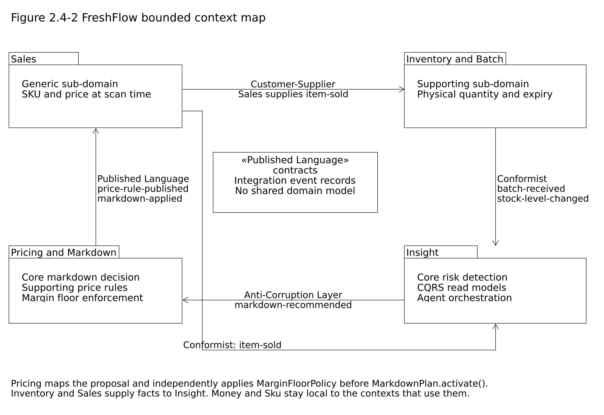
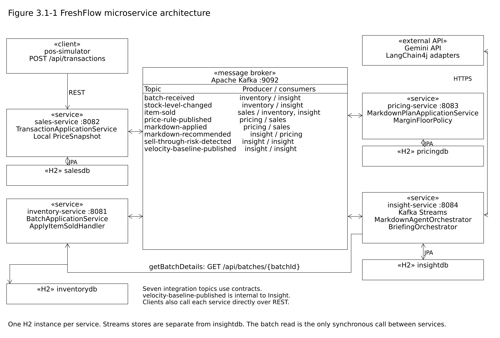
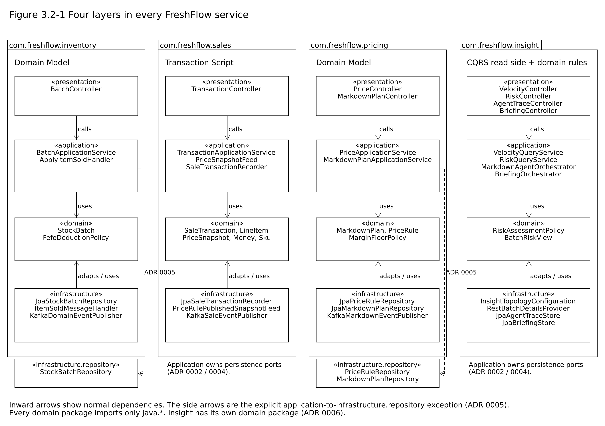

# FreshFlow

**Real-time expiry risk detection and agentic markdown decision support for grocery retail.**
CSCI318 Software Engineering Practices & Principles, Spring 2026, Group 06 "318 Hero":
Zihua (Andy) Zeng, Reuben Kruger, Modhuri (Madhuri) Dey Sithi.

A supermarket throws away perishable stock that reaches its expiry date unsold. FreshFlow
watches point-of-sale scans as they happen, works out which batches will not sell out before
they expire, and asks an LLM agent to propose a markdown for those batches. The agent may only
propose. Whether a markdown is allowed is decided by a deterministic rule, the margin floor,
inside the pricing service's domain layer, and that rule applies identically whether the
proposal came from a person or from the agent.

## Contents

1. [The system in one page](#1-the-system-in-one-page)
2. [Prerequisites](#2-prerequisites)
3. [Configuration](#3-configuration)
4. [Running it: the one-command way](#4-running-it-the-one-command-way)
5. [Running it: step by step](#5-running-it-step-by-step)
6. [A walk through the twelve use cases](#6-a-walk-through-the-twelve-use-cases)
7. [Looking inside while it runs](#7-looking-inside-while-it-runs)
8. [Tests](#8-tests)
9. [Where to look in the code](#9-where-to-look-in-the-code)
10. [Troubleshooting](#10-troubleshooting)
11. [Repository layout](#11-repository-layout)
12. [Known limitations](#12-known-limitations)

## 1. The system in one page

Four bounded contexts, one service each, integrated through Apache Kafka. The only synchronous
call between services is the agent's `getBatchDetails` tool, a `GET` from insight-service to
inventory-service. Each service owns its own H2 database.



| Bounded context | Service | Port | Domain pattern | Owns |
|---|---|---|---|---|
| Inventory & Batch | `inventory-service` | 8081 | Domain Model | stock batches, FEFO deduction, idempotent event ledger |
| Sales | `sales-service` | 8082 | Transaction Script | sale transactions, local price snapshot |
| Pricing & Markdown | `pricing-service` | 8083 | Domain Model | price rules, margin floors, markdown plans |
| Insight | `insight-service` | 8084 | CQRS read side with a small domain package | Kafka Streams velocity and risk views, the two agents |

Supporting modules: `contracts` (the Published Language: the integration event records, each
with an `eventId` and a producer-assigned `occurredAt`) and `pos-simulator` (a command-line
client that drives the demonstration).



Every service has the same four layers, and the dependency rule is the same everywhere: the
domain package imports nothing but `java.*`, and a test in each service fails if it ever does.



The closed loop the demonstration shows:

```
sale (POST /api/transactions)  -> item-sold
  -> inventory deducts FEFO     -> stock-level-changed
  -> insight windows velocity (FR12) and joins batch state (FR13)
  -> sell-through-risk-detected -> Markdown Decision Agent (FR14) -> markdown-recommended
  -> pricing checks the margin floor (FR11): ACTIVE plan + markdown-applied, or REJECTED
  -> sales applies the discounted price at the next scan (FR6b)
  -> store owner asks the Briefing Agent for the day's summary (FR15)
```

The full design is in `specs/` (architecture, requirements, domain model, API contract, stream
processing, agent orchestration), the decisions the specifications did not settle are in
`docs/decisions/`, and every AI collaboration session is logged in `docs/ai-log/`.

## 2. Prerequisites

| Tool | Version | Check |
|---|---|---|
| JDK | 21 | `java -version` |
| Docker Desktop | any recent | `docker info` prints a server version. Docker is used only for Kafka; an unpacked Kafka listening on `localhost:9092` works unchanged |
| Git | any | `git --version` |
| Maven | not needed; the wrapper `mvnw.cmd` / `mvnw` is committed | |
| A Google AI Studio API key | for FR14 and FR15 only | https://aistudio.google.com/apikey |

Everything else (Spring Boot 3, Spring Cloud Stream, Kafka Streams, LangChain4j 1.20.0, H2)
is resolved by Maven. No dependency outside the approved list in `specs/spec-01-architecture.md`
section 1.1 is used.

## 3. Configuration

All configuration is in each service's `src/main/resources/application.yml`. Only the LLM
settings come from the environment, and the key is never written to any file:

| Variable | Used by | Meaning |
|---|---|---|
| `LLM_API_KEY` | insight-service | Google AI Studio key. If it is unset, `GEMINI_API_KEY` is read instead. When neither is set the service still starts, serves FR12 and FR13, and logs that the agents are not configured |
| `LLM_MODEL` | insight-service | Model name. The live runs used `gemini-3.5-flash-lite`; any Gemini model your key may call works. The free tier caps requests per model per day, so keep a second model name in reserve for a demonstration |
| `LLM_PROVIDER` | insight-service | Defaults to `google-ai-gemini`, the only provider module built in |
| `FRESHFLOW_LLM_TEMPERATURE` | insight-service | Sampling temperature, default `0.0`, so a demonstration gives the same answer for the same facts |
| `INVENTORY_BASE_URL` | insight-service | Where the agent's `getBatchDetails` tool reads unit cost; default `http://localhost:8081` |
| `FRESHFLOW_KAFKA_BROKERS` | all services | Defaults to `localhost:9092` |

Set the two that matter in the PowerShell window that will start insight-service (they live
only in that window):

```powershell
$env:LLM_API_KEY = "paste-your-key-here"
$env:LLM_MODEL   = "gemini-3.5-flash-lite"
```

The agents' other settings, `freshflow.llm.timeout` (60 s) and `freshflow.llm.max-steps` (8),
are in `insight-service/src/main/resources/application.yml`.

## 4. Running it: the one-command way

Three scripts in `scripts/` do the whole procedure of section 5 in the right order and write
every service's console to `logs/`. Run them from PowerShell in the repository root. If your
execution policy refuses scripts, prefix each command with `powershell -ExecutionPolicy Bypass -File`,
for example `powershell -ExecutionPolicy Bypass -File .\scripts\start-all.ps1 -Fresh`.

```powershell
.\scripts\start-all.ps1 -Fresh
```

`-Fresh` wipes Kafka's data and insight-service's Kafka Streams state first, so the run starts
from nothing; leave it out to keep the broker's data. The script checks Java and Docker, starts
Kafka and waits for `healthy`, builds the jars if any is missing (`-Build` forces it), sets the
model name for insight-service (`-Model`, default `gemini-3.5-flash-lite`; the key is read from
`LLM_API_KEY` in your window and never written anywhere), opens one window per service and waits
until all four ports answer. `-NoAgent` starts without a model (FR12 and FR13 only).

```powershell
.\scripts\demo.ps1
```

Runs the closed loop (about four minutes) and, because the consoles are in `logs/`, finds the
agent's trace and the plan pricing-service made from it by itself. Run it straight after
`start-all.ps1` prints `Ready`; do not run `start-all.ps1` a second time in between (if you do, it
only tells you FreshFlow is already running), and do not run `stop-all.ps1` before the demo, because
that stops the services the demo needs. The order is always: start, demo, stop.

```powershell
.\scripts\stop-all.ps1
```

Stops the four services and leaves Kafka running. `-Kafka` also stops the broker and keeps its
data; `-Kafka -Wipe` removes the container and its data.

## 5. Running it: step by step

Open PowerShell in the repository root for each step. Six terminals are comfortable: one for
Kafka, four for the services, one for requests.

**1. Start Kafka** (single node, KRaft mode, from `docker-compose.yml`):

```powershell
docker compose up -d
docker compose ps
```

Wait until the `kafka` container reports `healthy`.

**2. Build everything, run the tests and install the modules** (about three minutes the first time):

```powershell
.\mvnw.cmd clean install
```

The build ends with `BUILD SUCCESS`. `install` matters: step 3 starts each service on its own,
and a per-module `spring-boot:run` resolves the shared `contracts` jar from the local Maven
repository, so an un-installed change to an event class shows up as `ClassNotFoundException`
at start-up.

**3. Start the four services, one per terminal, in this order** (pricing before sales so the
price snapshot is populated; insight last so its topology finds the topics):

```powershell
.\mvnw.cmd -pl inventory-service spring-boot:run
```
```powershell
.\mvnw.cmd -pl pricing-service spring-boot:run
```
```powershell
.\mvnw.cmd -pl sales-service spring-boot:run
```
```powershell
# in the window where LLM_API_KEY and LLM_MODEL are set
.\mvnw.cmd -pl insight-service spring-boot:run
```

Each service logs `Started ...Application` when ready. insight-service logs the model name and
temperature it is using, or a `[fr14-not-configured]` warning if no key is set.

**4. Run the demonstration script**, which seeds a price rule, registers batches, drives sales
through the POS simulator and prints every read model as it changes:

```powershell
.\scripts\demo.ps1
```

**5. Or drive it by hand** with the requests in section 6, or with the Postman collection at
`docs/postman/FreshFlow.postman_collection.json` (one folder per service, in demonstration
order, with collection variables for the ids).

**6. Stop**: `Ctrl+C` in each service window, then `docker compose stop` (keeps Kafka's data)
or `docker compose down -v` (discards it).

### Running from IntelliJ IDEA instead

Open the repository root as a Maven project. The `.run/` folder ships run configurations:
`0 FreshFlow: all four services` starts everything, and `5 pos-simulator` drives the demo.
For insight-service either start IntelliJ from a shell where `LLM_API_KEY` and `LLM_MODEL`
are exported, or add them under *Run > Edit Configurations > Environment variables*. Kafka
still has to be started with `docker compose up -d` first.

### Linux or macOS

Use `./mvnw` instead of `.\mvnw.cmd`, `export LLM_API_KEY=...` instead of `$env:`, and the
`curl` lines in section 6 instead of `Invoke-RestMethod`. Nothing else differs.

## 6. A walk through the twelve use cases

Section 2.1 of the project report specifies twelve use cases, UC-01 to UC-12, one per functional
requirement built. Each is driven by one of the requests below. Every request is given twice:
for Windows PowerShell with `Invoke-RestMethod` (single-quoted strings keep the JSON quotes
intact), and for `curl` (Linux, macOS, Git Bash; on Windows PowerShell write `curl.exe`).
Outputs captured from the live runs of 4 and 5 October 2026 are in `docs/evidence/`, one file
per use case.

**The error contract.** Every service answers a refused request with spec-04's `ErrorResponse`,
`{"error": CODE, "message": text}`. A rule in the application or domain layer that refuses the
request names itself in `error` (for example `QUANTITY_NOT_POSITIVE`, `PRICE_RULE_NOT_FOUND`,
`MARGIN_FLOOR_BREACH`). A body that cannot be parsed as JSON, or a path or query value of the
wrong type, never reaches those layers and is answered `400` with `error` `MALFORMED_REQUEST`
by the `GlobalExceptionHandler` in each service's presentation layer.

### UC-06 / FR8, create or replace a price rule and its margin floor (pricing, 8083)

```powershell
Invoke-RestMethod -Method Put -Uri http://localhost:8083/api/prices/SKU-STR-250G -ContentType 'application/json' -Body '{"basePrice":{"amount":6.00,"currency":"AUD"},"unitCost":{"amount":3.00,"currency":"AUD"},"category":"PRODUCE","marginFloorRatio":0.20}'
Invoke-RestMethod -Uri http://localhost:8083/api/prices/SKU-YOG-1KG
```
```bash
curl -s -X PUT http://localhost:8083/api/prices/SKU-STR-250G -H 'Content-Type: application/json' -d '{"basePrice":{"amount":6.00,"currency":"AUD"},"unitCost":{"amount":3.00,"currency":"AUD"},"category":"PRODUCE","marginFloorRatio":0.20}'
curl -s http://localhost:8083/api/prices/SKU-YOG-1KG
```

`PUT` answers `201` the first time and `200` on a replacement. `SKU-YOG-1KG` is seeded on
start-up (base 4.50, cost 2.10, floor 0.15) and announced on `price-rule-published`, which is how
sales-service learns the price. A base price below cost is refused with `BASE_PRICE_BELOW_COST`.

### UC-01 / FR1, register a goods receipt (inventory, 8081)

Use an expiry in the future.

```powershell
$batch = Invoke-RestMethod -Method Post -Uri http://localhost:8081/api/batches -ContentType 'application/json' -Body '{"sku":"SKU-YOG-1KG","quantity":400,"expiryAt":"2027-02-18T22:00:00Z","unitCost":{"amount":2.10,"currency":"AUD"},"supplierRef":"DEL-88213"}'
$batch
```
```bash
curl -s -X POST http://localhost:8081/api/batches -H 'Content-Type: application/json' -d '{"sku":"SKU-YOG-1KG","quantity":400,"expiryAt":"2027-02-18T22:00:00Z","unitCost":{"amount":2.10,"currency":"AUD"},"supplierRef":"DEL-88213"}'
```

The `201` body carries the `batchId` used below and `batch-received` is published. A quantity
of `0` or an expiry in the past answers `400` with the rule that refused it. `supplierRef` is
optional and is accepted but not stored: the goods-receipt record is out of scope in this
iteration (spec-03), and the batch itself is the record of the delivery.

### UC-03 / FR4, query stock and remaining shelf life (inventory, 8081)

```powershell
Invoke-RestMethod -Uri "http://localhost:8081/api/batches/$($batch.batchId)"
Invoke-RestMethod -Uri "http://localhost:8081/api/batches?sku=SKU-YOG-1KG"
```
```bash
curl -s http://localhost:8081/api/batches/BAT-XXXXXXXX
curl -s 'http://localhost:8081/api/batches?sku=SKU-YOG-1KG'
```

A single batch answers `200` or `404`; the SKU query lists the active batches in expiry order.

### UC-04 and UC-05 / FR5 and FR6a, record a sale at the base price (sales, 8082)

```powershell
Invoke-RestMethod -Method Post -Uri http://localhost:8082/api/transactions -ContentType 'application/json' -Body '{"tillId":"TILL-02","lineItems":[{"sku":"SKU-YOG-1KG","quantity":2}]}'
```
```bash
curl -s -X POST http://localhost:8082/api/transactions -H 'Content-Type: application/json' -d '{"tillId":"TILL-02","lineItems":[{"sku":"SKU-YOG-1KG","quantity":2}]}'
```

The `201` body prices each line from the local snapshot and one `item-sold` event per line item
is published. An empty `lineItems` answers `400 EMPTY_LINE_ITEMS`; an unknown SKU, `UNKNOWN_SKU`.

### UC-02 / FR2, stock is deducted first-expired-first-out (inventory, 8081)

Read the batch again. The remaining quantity has dropped by 2 and `stock-level-changed` has been
published; the same `item-sold` delivered twice is deducted once, because the ledger remembers
its `eventId`.

```powershell
Invoke-RestMethod -Uri "http://localhost:8081/api/batches/$($batch.batchId)"
```
```bash
curl -s http://localhost:8081/api/batches/BAT-XXXXXXXX
```

### UC-09 / FR12, rolling sell-through velocity (insight, 8084)

Available once the first 60-second window has closed; `404` before that is the specified answer.

```powershell
Invoke-RestMethod -Uri http://localhost:8084/api/insight/velocity/SKU-YOG-1KG
```
```bash
curl -s http://localhost:8084/api/insight/velocity/SKU-YOG-1KG
```

The body gives units per hour over the last closed window, the seeded baseline and the ratio
between them, all computed on the events' own `occurredAt`.

### UC-10 / FR13, batches at risk of expiring unsold (insight, 8084)

```powershell
Invoke-RestMethod -Uri http://localhost:8084/api/insight/risks
```
```bash
curl -s http://localhost:8084/api/insight/risks
```

A risk appears when a batch's remaining quantity exceeds what its current velocity can sell
before expiry, and `sell-through-risk-detected` is published once, on the transition into risk.
The simulator's `--seed-batches=true` registers 400 units expiring in 70 minutes for exactly
this purpose.

### UC-11 / FR14, the Markdown Decision Agent (insight, 8084)

Triggered by the risk event, not by a request. Watch insight-service's log for
`[fr14-trace] agentTraceId=TRC-...`, then read the trace: every tool call the agent made, its
result, and the final recommendation (the proposed tier and window, `NO_MARKDOWN`, or
`PROPOSED_BUT_UNRESOLVABLE` when the batch could not be resolved). A proposal for a batch other
than the one that triggered the agent is refused by the orchestrator and recorded as declined.

```powershell
Invoke-RestMethod -Uri http://localhost:8084/api/insight/agent-traces/TRC-XXXXXXXX
```
```bash
curl -s http://localhost:8084/api/insight/agent-traces/TRC-XXXXXXXX
```

### UC-07 / FR9, activate a markdown plan within the margin floor (pricing, 8083)

The agent's recommendation arrives on `markdown-recommended` and runs the same application
service and the same domain rule as this request; a supervisor can also propose directly:

```powershell
$plan = Invoke-RestMethod -Method Post -Uri http://localhost:8083/api/markdown-plans -ContentType 'application/json' -Body ('{"batchId":"' + $batch.batchId + '","sku":"SKU-YOG-1KG","discountTier":"PERCENT_30","effectiveFrom":"2026-10-01T00:00:00Z","effectiveTo":"2027-02-18T22:00:00Z","origin":"HUMAN","rationale":"Clearance before the weekend"}')
$plan
```
```bash
curl -s -X POST http://localhost:8083/api/markdown-plans -H 'Content-Type: application/json' -d '{"batchId":"BAT-XXXXXXXX","sku":"SKU-YOG-1KG","discountTier":"PERCENT_30","effectiveFrom":"2026-10-01T00:00:00Z","effectiveTo":"2027-02-18T22:00:00Z","origin":"HUMAN","rationale":"Clearance before the weekend"}'
```

`201` with the plan `ACTIVE`, and `markdown-applied` is published.

### UC-08 / FR11, a markdown that breaches the floor is refused with 422 (pricing, 8083)

The refusal is kept as a `REJECTED` plan. `PERCENT_60` on the seeded SKU yields a negative
margin:

```powershell
try { Invoke-RestMethod -Method Post -Uri http://localhost:8083/api/markdown-plans -ContentType 'application/json' -Body ('{"batchId":"' + $batch.batchId + '","sku":"SKU-YOG-1KG","discountTier":"PERCENT_60","effectiveFrom":"2026-10-01T00:00:00Z","effectiveTo":"2027-02-18T22:00:00Z","origin":"AGENT","rationale":"Aggressive clearance","agentTraceId":"TRC-DEMO-0002"}') } catch { $_.ErrorDetails.Message }
Invoke-RestMethod -Uri "http://localhost:8083/api/markdown-plans/$($plan.markdownPlanId)"
```
```bash
curl -s -X POST http://localhost:8083/api/markdown-plans -H 'Content-Type: application/json' -d '{"batchId":"BAT-XXXXXXXX","sku":"SKU-YOG-1KG","discountTier":"PERCENT_60","effectiveFrom":"2026-10-01T00:00:00Z","effectiveTo":"2027-02-18T22:00:00Z","origin":"AGENT","rationale":"Aggressive clearance","agentTraceId":"TRC-DEMO-0002"}'
curl -s http://localhost:8083/api/markdown-plans/MDP-XXXXXXXX
```

### UC-05 / FR6b, the markdown reaches the till (pricing 8083, sales 8082)

After the `201` of UC-07, `GET /api/prices/SKU-YOG-1KG` shows `effectivePrice` 3.15 and
`activeDiscountTier` PERCENT_30, and the next sale records `markdownApplied: true`:

```powershell
Invoke-RestMethod -Uri http://localhost:8083/api/prices/SKU-YOG-1KG
Invoke-RestMethod -Method Post -Uri http://localhost:8082/api/transactions -ContentType 'application/json' -Body '{"tillId":"TILL-02","lineItems":[{"sku":"SKU-YOG-1KG","quantity":1}]}'
```
```bash
curl -s http://localhost:8083/api/prices/SKU-YOG-1KG
curl -s -X POST http://localhost:8082/api/transactions -H 'Content-Type: application/json' -d '{"tillId":"TILL-02","lineItems":[{"sku":"SKU-YOG-1KG","quantity":1}]}'
```

### UC-12 / FR15, the end-of-day briefing (insight, 8084; needs the LLM key)

```powershell
$briefing = Invoke-RestMethod -Method Post -Uri http://localhost:8084/api/insight/briefings -ContentType 'application/json' -Body '{}'
$briefing
Invoke-RestMethod -Uri "http://localhost:8084/api/insight/briefings/$($briefing.briefingId)"
```
```bash
curl -s -X POST http://localhost:8084/api/insight/briefings -H 'Content-Type: application/json' -d '{}'
curl -s http://localhost:8084/api/insight/briefings/BRF-XXXXXXXX
```

The agent reads this service's own stores through three read-only tools and writes a short
summary; the orchestrator checks the numbers in the prose against the tool results before
storing it. Without a key the endpoint answers `503 AGENT_NOT_CONFIGURED`, which is the
specified behaviour. With a key whose model cannot be used just now (a spent daily quota, a
timeout) it answers `503 AGENT_UNAVAILABLE` with the reason, stores nothing, and the rest of
the service is unaffected.

### The POS simulator

```powershell
java -cp pos-simulator\target\classes com.freshflow.possimulator.PosSimulator --rate=4 --duration=180 --seed-batches=true
```

Keep `--rate` low when you want FR13 to fire: at 4 transactions a minute the seeded 400-unit
batch sells about 240 units an hour against the hour or so it has left, so it is flagged; at the
simulator's built-in default of 30 a minute it clears on its own and is never at risk.

Options: `--sales-url`, `--inventory-url`, `--rate` (transactions per minute, default 30),
`--duration` (seconds), `--seed` (deterministic randomness), `--skus=SKU:weight,...`, `--till`,
`--seed-batches`. The simulator is JDK-only and depends on no other module.

## 7. Looking inside while it runs

### The event stream

Every topic can be read with the console consumer inside the Kafka container, which is the
quickest way to show the closed loop during a demonstration:

```powershell
docker exec -it freshflow-kafka /opt/kafka/bin/kafka-console-consumer.sh --bootstrap-server localhost:9092 --topic item-sold --from-beginning
```

Replace the topic with `batch-received`, `stock-level-changed`, `sell-through-risk-detected`,
`markdown-recommended`, `markdown-applied` or `price-rule-published`.

### The databases

Each service runs the H2 console at runtime (not under the `test` profile). Open the URL in a
browser, enter the JDBC URL, user `sa`, no password:

| Service | Console | JDBC URL |
|---|---|---|
| inventory-service | http://localhost:8081/h2-console | `jdbc:h2:mem:inventorydb` |
| sales-service | http://localhost:8082/h2-console | `jdbc:h2:mem:salesdb` |
| pricing-service | http://localhost:8083/h2-console | `jdbc:h2:mem:pricingdb` |
| insight-service | http://localhost:8084/h2-console | `jdbc:h2:mem:insightdb` |

Tables worth opening: `stock_batch` and `consumed_event` (the idempotent ledger) in inventory,
`sale_transaction` in sales, `price_rule` and `markdown_plan` in pricing, and `agent_trace`,
`agent_tool_call`, `briefing` and `briefing_tool_call` in insight. The Kafka Streams state (velocity windows, batch states, batch risks)
is not in H2; it lives in the service's state stores and is read through the endpoints.

## 8. Tests

```powershell
.\mvnw.cmd test
```

207 tests across the six modules (inventory 23, sales 21, pricing 57, insight 91,
pos-simulator 15), and every one runs without Kafka and without a network
connection: the Kafka adapters are switched off by the `test` profile, and the agents run
against deterministic stubs behind their ports (ADR 0004). The suite passes with `LLM_API_KEY`
and `LLM_MODEL` unset and with both set to any value (ADR 0004, Check B).

Three kinds of test enforce the architecture mechanically rather than by review:

- a domain-import guard in every service (`*DomainDependencyRuleTest`) fails if a domain
  package imports anything outside `java.*`;
- `AntiCorruptionLayerGuardTest` fails if any insight-service source mentions pricing or a
  margin floor, system prompts included;
- `MarkdownAgentTestProfileGuardTest` starts the context under the test profile with a key set
  and asserts that no model client exists.

The Kafka Streams topology is tested on its own under `TopologyTestDriver`
(`InsightTopologyTest`): windows placed by `occurredAt` while the record timestamps are
decades away, the suppress-until-close, the stream-table join, one risk event per transition,
and the `stock-level-changed` fold.

## 9. Where to look in the code

### The agents

| Concern | Class |
|---|---|
| The port the orchestrator depends on | [`MarkdownDecisionAgent.java`](insight-service/src/main/java/com/freshflow/insight/application/MarkdownDecisionAgent.java), [`BriefingAgent.java`](insight-service/src/main/java/com/freshflow/insight/application/BriefingAgent.java) |
| The three tools of each agent | [`AgentToolRegistry.java`](insight-service/src/main/java/com/freshflow/insight/application/AgentToolRegistry.java), [`BriefingToolRegistry.java`](insight-service/src/main/java/com/freshflow/insight/application/BriefingToolRegistry.java) |
| The orchestration rules (idempotency, refusing a foreign batch, the outcomes) | [`MarkdownAgentOrchestrator.java`](insight-service/src/main/java/com/freshflow/insight/application/MarkdownAgentOrchestrator.java), [`BriefingOrchestrator.java`](insight-service/src/main/java/com/freshflow/insight/application/BriefingOrchestrator.java) |
| The LangChain4j adapter and the system prompt | [`LangChain4jMarkdownDecisionAgent.java`](insight-service/src/main/java/com/freshflow/insight/infrastructure/LangChain4jMarkdownDecisionAgent.java), [`LangChain4jBriefingAgent.java`](insight-service/src/main/java/com/freshflow/insight/infrastructure/LangChain4jBriefingAgent.java) |
| Model construction, guarded by profile and by the presence of the key | `infrastructure/MarkdownAgentConfiguration.java`, `infrastructure/BriefingAgentConfiguration.java` |
| The persisted trace | `infrastructure/AgentTraceEntity.java`, `ToolCallEntity.java`, `BriefingEntity.java` |
| The guard that keeps pricing out of this service | `src/test/java/com/freshflow/insight/AntiCorruptionLayerGuardTest.java` |

### Stream processing

| Concern | Class |
|---|---|
| The topology: hopping window on event time, batch-state table, stream-table join, the risk transition | [`InsightTopologyConfiguration.java`](insight-service/src/main/java/com/freshflow/insight/infrastructure/InsightTopologyConfiguration.java) |
| Event time, one extractor for every input topic | [`OccurredAtTimestampExtractor.java`](insight-service/src/main/java/com/freshflow/insight/infrastructure/OccurredAtTimestampExtractor.java) |
| Interactive queries behind the application ports | [`InteractiveQueryVelocityWindowStore.java`](insight-service/src/main/java/com/freshflow/insight/infrastructure/InteractiveQueryVelocityWindowStore.java), `InteractiveQueryRiskViewStore.java` |
| The rule that decides a batch is at risk | [`RiskAssessmentPolicy.java`](insight-service/src/main/java/com/freshflow/insight/domain/RiskAssessmentPolicy.java) (domain package, ADR 0006) |
| The same topology read as SQL | `specs/spec-05-stream-processing.md` section 1.4 |

### The domain layers

| Concern | Class |
|---|---|
| The stock batch aggregate and FEFO across batches | [`StockBatch.java`](inventory-service/src/main/java/com/freshflow/inventory/domain/StockBatch.java), [`FefoDeductionPolicy.java`](inventory-service/src/main/java/com/freshflow/inventory/domain/FefoDeductionPolicy.java) |
| The markdown plan aggregate and the margin floor | [`MarkdownPlan.java`](pricing-service/src/main/java/com/freshflow/pricing/domain/MarkdownPlan.java), [`MarginFloorPolicy.java`](pricing-service/src/main/java/com/freshflow/pricing/domain/MarginFloorPolicy.java) |
| The one application service both the endpoint and the agent's recommendation go through | [`MarkdownPlanApplicationService.java`](pricing-service/src/main/java/com/freshflow/pricing/application/MarkdownPlanApplicationService.java) |
| The transaction script and its price snapshot | [`TransactionApplicationService.java`](sales-service/src/main/java/com/freshflow/sales/application/TransactionApplicationService.java), [`PriceSnapshotFeed.java`](sales-service/src/main/java/com/freshflow/sales/application/PriceSnapshotFeed.java) |
| Repository interfaces, in the persistence layer | `*/infrastructure/repository/` (ADR 0005) |

## 10. Troubleshooting

| Symptom | Cause and fix |
|---|---|
| `GET /api/insight/velocity/{sku}` answers 404 | No 60-second window has closed for that SKU yet, or the last one aged out of the 10-minute retention. Keep sales flowing and retry |
| No risk appears | The batch clears at the current velocity. The simulator's seeded batch (400 units, 70 minutes to expiry) is only at risk while sales stay below roughly 6 transactions a minute, which is why `demo.ps1` defaults to 4; a run at the simulator's own default of 30 a minute sells the batch out instead. Check `GET /api/batches?sku=` shows it ACTIVE |
| insight-service logs `[fr14-not-configured]` | Neither `LLM_API_KEY` nor `GEMINI_API_KEY` is set in the window that started it. Set one and restart that service only |
| `POST /api/insight/briefings` answers 503 `AGENT_NOT_CONFIGURED` | Same cause as above |
| `POST /api/insight/briefings` answers 503 `AGENT_UNAVAILABLE`, or insight-service logs `[fr14-agent-unavailable]` | The model is configured but refused the call; the body names the reason. The commonest cause is the Gemini free tier's daily request quota for that model (a 429 whose message says `GenerateRequestsPerDayPerProjectPerModel-FreeTier`). Set `LLM_MODEL` to a different model name and restart insight-service, or wait for the quota to reset; nothing was stored and FR12 and FR13 are unaffected |
| insight-service logs `Failed to change permissions for the directory ...\kafka-streams` at start-up | Kafka Streams tries to set POSIX permissions on its state directory, which Windows does not support. The message is logged at ERROR level but is harmless: the topology starts and the stores work |
| Gemini answers 400 about a thought signature | Handled in `MarkdownAgentConfiguration` (`sendThinking`, `returnThinking`); make sure you are on the current `main` |
| A markdown stopped applying at the till after pricing-service was restarted | On start-up pricing-service re-announces its seeded rules with a fresh timestamp, and sales-service treats a newer rule as displacing the markdown attached to it (logged `[displaced]`). Activate the markdown again, or restart sales-service after pricing-service so both topics replay in order |
| Kafka Streams fails to start after a crash | Stop insight-service, delete its state directory (`/tmp/kafka-streams` on Linux or macOS, `%TEMP%\kafka-streams` on Windows) and start it again; the stores rebuild from the changelog topics |
| `docker compose up` says the port is in use | Another Kafka or an old container is on 9092; `docker compose down` then up again |
| `mvnw.cmd` fails from Git Bash | The repository path contains an ampersand, which `cmd.exe` misreads; run the wrapper from PowerShell |
| A request answers 400 `MALFORMED_REQUEST` | The JSON body could not be parsed (a missing brace or quote, a number where a string is expected). Check the body against the examples in section 6 or spec-04 |

## 11. Repository layout

```
contracts/            integration event records (the Published Language)
inventory-service/    com.freshflow.inventory.{presentation,application,domain,infrastructure}
sales-service/        com.freshflow.sales.{presentation,application,domain,infrastructure}
pricing-service/      com.freshflow.pricing.{presentation,application,domain,infrastructure}
insight-service/      com.freshflow.insight.{presentation,application,domain,infrastructure}
pos-simulator/        command-line demonstration client (JDK only)
specs/                spec-01 architecture, spec-02 requirements, spec-03 domain model,
                      spec-04 API contract (OpenAPI), spec-05 stream processing,
                      spec-06 agent orchestration, dev-agent-prompt.md
docs/decisions/       ADR 0001 to 0006
docs/ai-log/          one log per AI collaboration session, with an index in README.md
docs/prompts/         the prompts that started the larger sessions
docs/evidence/        requests and responses captured from the live runs, one file per use case
docs/postman/         Postman collection
scripts/              start-all.ps1, demo.ps1, stop-all.ps1, kafka-smoke-test.ps1
assets/               the diagrams shown in this README
.run/                 IntelliJ run configurations
docker-compose.yml    single-node Kafka
CLAUDE.md             the constraints the AI coding agent works under
```

Package names map to the subject's four layers as presentation = `presentation`, service =
`application`, domain = `domain`, data access = `infrastructure`, with repository interfaces in
`infrastructure.repository` (ADR 0005). The fourth package is wider than "data access" because
it also holds the Kafka adapters, the LangChain4j adapters and the configuration classes;
spec-01 section 2.1 carries the full mapping table.

## 12. Known limitations

- A SKU that stops selling entirely is not re-assessed for risk, because assessment is
  triggered by a closing velocity window (spec-05, G-4).
- Trading hours are configuration; the projection uses 24 clock hours unless changed (G-3).
- A batch in its final hour before expiry drops out of the risk list, because the remaining
  time is counted in whole hours; accepted for submission by team ruling (spec-05, G-8).
- The `occurredAt` wire format is pinned by a test for `markdown-recommended` only; the other
  topics rely on the serialiser configuration (spec-05, G-6).
- The save-then-publish window in the agent orchestrator is accepted rather than closed with
  an outbox (spec-06, G-7).
- FR3 write-offs, FR7 transaction history and FR10 automatic markdown expiry are specified
  but not built; the briefing says so instead of inventing a waste figure.
